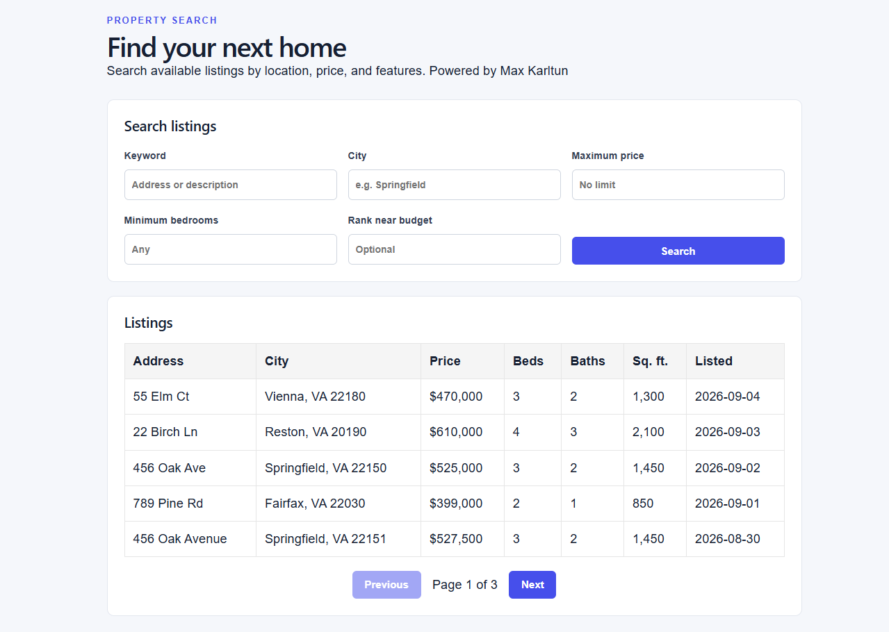

# 3D Search



A dimensional property-search experience built with React, Vite, and Express. The interface uses lightweight CSS 3D styling and searches sample listing data stored in a JSON file.

## Project structure

- `backend/` — Express API and sample listing data
- `frontend/` — React user interface

## Setup and run

You need Node.js and npm installed.

### Start the backend

From the project folder, run:

```powershell
cd backend
npm install
npm start
```

The API runs at `http://localhost:3000`. Keep this terminal open.

### Start the frontend

Open a second terminal from the project folder and run:

```powershell
cd frontend
npm install
npm run dev
```

Open the Local URL shown by Vite, usually `http://localhost:5173`. Keep this terminal open too.

## Search API

The backend provides this endpoint:

`GET http://localhost:3000/api/listings`

Optional query parameters:

| Parameter | What it does |
|---|---|
| `keyword` | Finds text in the listing's address, city, state, ZIP code, or description. |
| `city` | Keeps listings whose city contains the provided text, ignoring letter case. |
| `maxPrice` | Keeps listings at or below this price. |
| `minBedrooms` | Keeps listings with at least this many bedrooms. |
| `budget` | Ranks matching listings by closeness of price to this amount; it does not filter listings out. |
| `page` | Selects the results page. Defaults to page 1. |
| `limit` | Sets results per page. Defaults to 10 and is capped at 50. The frontend requests 5. |

Example request:

`http://localhost:3000/api/listings?city=Springfield&budget=500000&page=1&limit=5`

This requests up to five Springfield listings on page 1, ranked by closeness to $500,000.

The response includes:

- `page` — current page number
- `limit` — requested page size
- `total` — number of listings matching the filters
- `totalPages` — number of result pages
- `results` — listings for the current page

The frontend sends searches to the Express API through Vite's `/api` development proxy.

## Assumptions and ranking

- Sample listings are loaded from `backend/data/sample_listings.json`.
- Search filters are applied before results are ranked and divided into pages.
- `maxPrice` filters results; `budget` only affects their order.
- When a budget is provided, listings closest in price appear first.
- Listings equally close to the budget—or all listings when no budget is given—are ordered by listing date, newest first.
- The frontend displays five listings per page.

## Future enhancements

- Store listings in a database such as PostgreSQL.
- Add automated backend and frontend tests.
- Add more search filters and listing details.
- Prepare the application for deployment.
